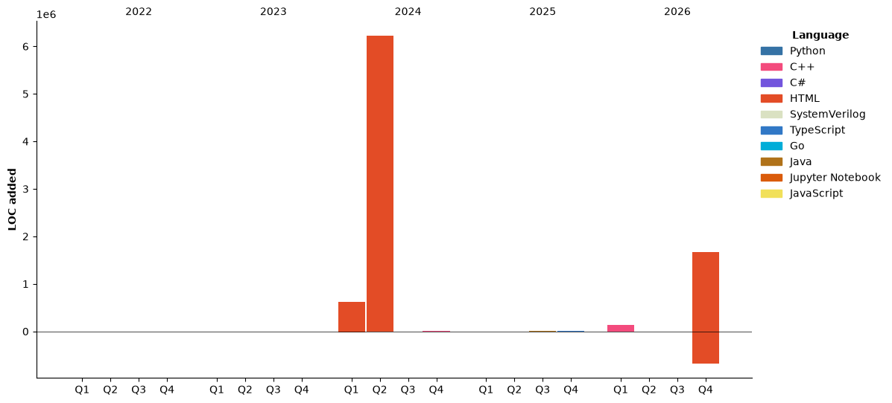

# bemooooooooo's home
### Hi there 👋, my name is Vladimir!
#### I am a student.
Working on my own projects and hikku.

Skills:      
<!---->

[](https://github.com/anuraghazra/github-readme-stats)

<!--START_SECTION:waka-->


**🐱 My GitHub Data** 

> 📦 395.8 kB Used in GitHub's Storage 
 > 
> 🏆 11 Contributions in the Year 2026
 > 
> 🚫 Not Opted to Hire
 > 
> 📜 26 Public Repositories 
 > 
> 🔑 8 Private Repositories 
 > 
**I'm a Night 🦉** 

```text
🌞 Morning                53 commits          █░░░░░░░░░░░░░░░░░░░░░░░░   05.58 % 
🌆 Daytime                313 commits         ████████░░░░░░░░░░░░░░░░░   32.98 % 
🌃 Evening                454 commits         ████████████░░░░░░░░░░░░░   47.84 % 
🌙 Night                  129 commits         ███░░░░░░░░░░░░░░░░░░░░░░   13.59 % 
```
📅 **I'm Most Productive on Wednesday** 

```text
Monday                   124 commits         ███░░░░░░░░░░░░░░░░░░░░░░   13.07 % 
Tuesday                  114 commits         ███░░░░░░░░░░░░░░░░░░░░░░   12.01 % 
Wednesday                302 commits         ████████░░░░░░░░░░░░░░░░░   31.82 % 
Thursday                 188 commits         █████░░░░░░░░░░░░░░░░░░░░   19.81 % 
Friday                   25 commits          █░░░░░░░░░░░░░░░░░░░░░░░░   02.63 % 
Saturday                 145 commits         ████░░░░░░░░░░░░░░░░░░░░░   15.28 % 
Sunday                   51 commits          █░░░░░░░░░░░░░░░░░░░░░░░░   05.37 % 
```


📊 **This Week I Spent My Time On** 

```text
🕑︎ Time Zone: Asia/Yekaterinburg

💬 Programming Languages: 
PowerShell               35 mins             ██████░░░░░░░░░░░░░░░░░░░   22.19 % 
JavaScript               31 mins             █████░░░░░░░░░░░░░░░░░░░░   19.63 % 
Markdown                 26 mins             ████░░░░░░░░░░░░░░░░░░░░░   16.25 % 
SQL                      21 mins             ███░░░░░░░░░░░░░░░░░░░░░░   13.34 % 
YAML                     16 mins             ███░░░░░░░░░░░░░░░░░░░░░░   10.32 % 

🔥 Editors: 
Codex Vscode             2 hrs 25 mins       ███████████████████████░░   90.73 % 
VS Code                  14 mins             ██░░░░░░░░░░░░░░░░░░░░░░░   09.27 % 

🐱‍💻 Projects: 
work                     2 hrs 37 mins       █████████████████████████   98.07 % 
referenced-chatgpt-conver3 mins              ░░░░░░░░░░░░░░░░░░░░░░░░░   01.93 % 

💻 Operating System: 
Windows                  2 hrs 40 mins       █████████████████████████   100.00 % 
```

🤖 **AI Coding This Week** 

```text
⏱ AI Coding Time: 2 hrs 25 mins (90.73%)

✍️ 3,220 lines written by AI, 1 lines written by hand (99.97% AI-written)

🔤 1,943,634 Input Tokens, 259,032 Output Tokens

💵 $10.96 Estimated AI Cost This Week

🧠 7 AI Sessions, 19 AI Prompts

GPT                      3,221 lines         █████████████████████████   100.00 % 

🔎 AI Coding Insights:
🤖 AI-Driven — 99.97% of written lines came from AI
📄 Detailed Prompter — average 631 characters per prompt
🔁 Iterative Prompter — average 3 prompts per session
🚀 High AI Trust — 0.03% of changed lines were hand-edited
```

**I Mostly Code in C++** 

```text
Python                   7 repos             ████░░░░░░░░░░░░░░░░░░░░░   17.07 % 
Go                       6 repos             ████░░░░░░░░░░░░░░░░░░░░░   14.63 % 
HTML                     4 repos             ██░░░░░░░░░░░░░░░░░░░░░░░   09.76 % 
JavaScript               2 repos             █░░░░░░░░░░░░░░░░░░░░░░░░   04.88 % 
TypeScript               2 repos             █░░░░░░░░░░░░░░░░░░░░░░░░   04.88 % 
```


**Timeline**




 Last Updated on 31/10/2026 21:47:49 UTC
<!--END_SECTION:waka-->

## Projects:
[](https://github.com/bemooooooooo/Gui-for-DataBase) [](https://github.com/bemooooooooo/FileService)
